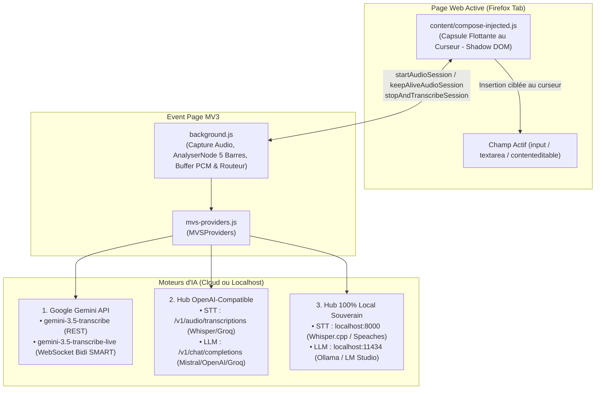

# ARCHITECTURE.md — Magic Voice Scriber for Firefox

Ce document décrit l'architecture technique interne, les flux de données et les choix d'ingénierie de **Magic Voice Scriber** pour Mozilla Firefox (Manifest V3).

---

## 1. Vue d'Ensemble du Système

**Magic Voice Scriber** est une WebExtension Manifest V3 pure en Vanilla JavaScript :
- **Content Script (`content/compose-injected.js`)** : Détecte le champ de saisie actif (`<textarea>`, `<input type="text">`, ou élément `contenteditable="true"`), calcule les coordonnées du curseur et affiche la capsule flottante.
- **Arrière-Plan Privilégié (`background.js`)** : Event Page MV3 gérant la capture microphone via `getUserMedia`, l'analyse audio des 5 barres, le streaming WebSocket Bidi Live avec Manual VAD strict, et les appels REST vers les moteurs d'IA.
- **Moteur Polyvalent (`mvs-providers.js`)** : Encapsule les 3 familles d'IA (Gemini, OpenAI/Mistral/Groq, Local).



---

## 2. Structure des Fichiers

```text
magic-voice-scriber-firefox/
├── manifest.json                  # Manifeste WebExtension MV3 (Firefox >= 128.0)
├── background.js                  # Event Page : capture micro, 5 barres d'ondes, streaming Live, KeepAlive
├── mvs-providers.js               # Orchestrateur des 3 familles de moteurs IA + prompts Rambler
├── content/
│   ├── compose-injected.js        # Capsule flottante injectée au curseur (Shadow DOM)
│   ├── compose.html               # Structure de la capsule
│   ├── compose.css                # Styles glassmorphism
│   └── compose.js                 # Logique du widget
├── options/
│   ├── options.html               # Interface de paramétrage multi-fournisseurs
│   ├── options.css                # Styles de la page d'options
│   └── options.js                 # Logique de configuration, presets et test de connexion
├── icons/                         # Icônes PNG détourées Alpha (16, 32, 48, 64, 128)
├── _locales/                      # Dictionnaires i18n (en, fr, es, pt, de, vi)
├── test/
│   └── mvs.test.js                # Suite de tests unitaires automatisés
├── build.sh                       # Script de packaging .xpi vers dist/ avec garde-fou DEBUG
└── icon.png                       # Icône officielle 128x128
```

---

## 3. Sécurité & Conformité CSP MV3

- **Zéro innerHTML / outerHTML / insertAdjacentHTML**.
- **Zéro eval() / new Function()**.
- **Zéro boîte de dialogue bloquante** (`window.alert`, `confirm`, `prompt`).
- **Isolation Shadow DOM** pour éviter tout conflit de style avec les pages hôtes.
