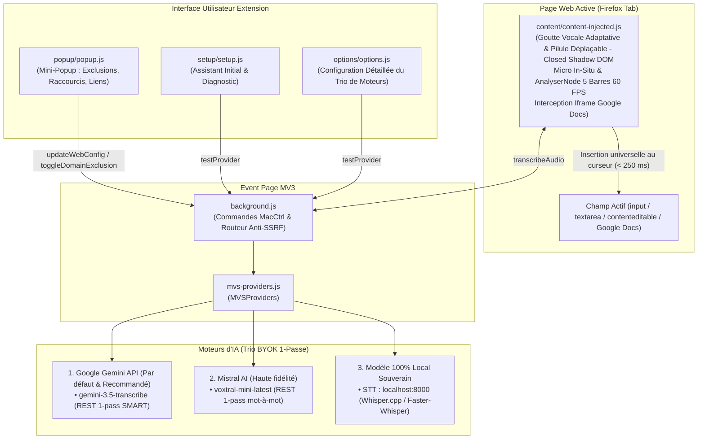

# ARCHITECTURE.md — Magic Voice Scriber for Firefox

Ce document décrit l'architecture technique interne, les flux de données et les choix d'ingénierie de **Magic Voice Scriber** pour Mozilla Firefox (Manifest V3).

---

## 1. Vue d'Ensemble du Système

**Magic Voice Scriber** est une WebExtension Manifest V3 pure en Vanilla JavaScript :
- **Injection Web Universelle & Micro In-Situ (`content/content-injected.js`)** : Détecte les champs éligibles (`<textarea>`, `<input>`, `contenteditable="true"`, Google Docs canvas proxy), affiche la Goutte Vocale (Caret Gem) dans un Shadow DOM fermé (`mode: "closed"`) avec un positionnement géométrique adaptatif (calage haut-droit sur textareas et éditeurs étendus, centrage vertical sur inputs mono-lignes, et calage en bas à droite sur Google Docs pour ne pas masquer le bouton natif Gemini). Intègre une capsule sonore déplaçable à la souris (Draggable Vanilla JS avec mémorisation de session). Capture le microphone directement dans l'onglet actif (`getUserMedia`), anime les 5 barres d'ondes à 60 FPS sans latence inter-scripts (`AudioContext` + `AnalyserNode`), et insère le texte transcrit via des setters de prototypes natifs et événements synthétiques. Stratégie Keyboard-First avec interception des raccourcis au niveau de `window` en capture et liaison dynamique à l'iframe proxy de Google Docs (`.docs-texteventtarget-iframe`).
- **Mini-Popup de Contrôle (`popup/`)** : Déclenchée via l'icône de barre d'outils (`action`), permet d'activer/désactiver le domaine courant, de basculer la présence de la Goutte Vocale dans le champ actif, de basculer le raccourci (`Alt+Shift+S` ou `Alt+Shift+D` avec détection `⌃ ⇧ S` sur macOS), et d'accéder au Wizard et aux Options.
- **Assistant & Diagnostic Initial (`setup/`)** : Assistant pas-à-pas guidant l'utilisateur pour la configuration du Trio (Google Gemini par défaut, Mistral, Local) avec bac à sable interactif et test micro incluant la pédagogie factualisée de l'autorisation par domaine dans Firefox.
- **Arrière-Plan Privilégié (`background.js`)** : Event Page MV3 gérant le minting sécurisé des jetons éphémères de session Mistral Realtime (`POST /v1/client/sessions`), la commande native Firefox (`MacCtrl+Shift+S` sous macOS et `Alt+Shift+S` sous Windows/Linux), la synchronisation dynamique (`api.commands.update`), et le routage sécurisé des requêtes réseau anti-SSRF.
- **Moteur Polyvalent (`mvs-providers.js`)** : Encapsule le Trio de moteurs d'IA en Push-to-Talk 1 passe ultra-rapide (< 250 ms) :
  1. **Google Gemini (Par défaut & Recommandé)** : `gemini-3.5-transcribe` en mode SMART 1 passe natif sans prompt artificiel (filtrage sémantique des hésitations et faux départs).
  2. **Mistral AI (Haute fidélité)** : `voxtral-mini-latest` en 1 passe REST directe pour une transcription mot-à-mot ultra-précise.
  3. **Modèle 100 % Local** : Serveur Whisper local (Faster-Whisper / Speaches sur `localhost:8000`).



---

## 2. Structure des Fichiers

```text
magic-voice-scriber-firefox/
├── manifest.json                  # Manifeste WebExtension MV3 (Firefox >= 142.0)
├── background.js                  # Event Page : minting de session éphémère Mistral rt_*, relais WebSocket, commands.update
├── mvs-providers.js               # Orchestrateur du Trio de moteurs IA (Mistral, Gemini, Local)
├── content/
│   └── content-injected.js        # Goutte Vocale (Closed Shadow DOM), micro in-situ, 5 barres 60 FPS, insertion
├── popup/
│   ├── popup.html                 # Mini-popup compacte
│   ├── popup.css                  # Styles glassmorphism mini-popup
│   └── popup.js                   # Contrôle d'exclusion de site, Caret Gem switch, raccourci clavier
├── setup/
│   ├── setup.html                 # Assistant de configuration initiale & diagnostic
│   ├── setup.css                  # Styles du wizard
│   └── setup.js                   # Logique pas-à-pas (clé API, test micro, bac à sable)
├── options/
│   ├── options.html               # Interface de paramétrage du Trio de moteurs
│   ├── options.css                # Styles de la page d'options
│   └── options.js                 # Logique de configuration et test de connexion en direct
├── icons/                         # Icônes PNG détourées Alpha (16, 32, 48, 64, 128)
├── _locales/                      # Dictionnaires i18n (en, fr, es, pt, de, vi)
├── test/
│   └── mvs.test.js                # Suite de 25 tests unitaires automatisés (100% succès)
├── build.sh                       # Script de packaging .xpi vers dist/ avec garde-fou DEBUG
└── icon.png                       # Icône officielle 128x128
```

---

## 3. Sécurité & Conformité CSP MV3

- **Zéro innerHTML / outerHTML / insertAdjacentHTML**.
- **Zéro eval() / new Function()**.
- **Zéro boîte de dialogue bloquante** (`window.alert`, `confirm`, `prompt`).
- **Isolation Shadow DOM** pour éviter tout conflit de style avec les pages hôtes.
