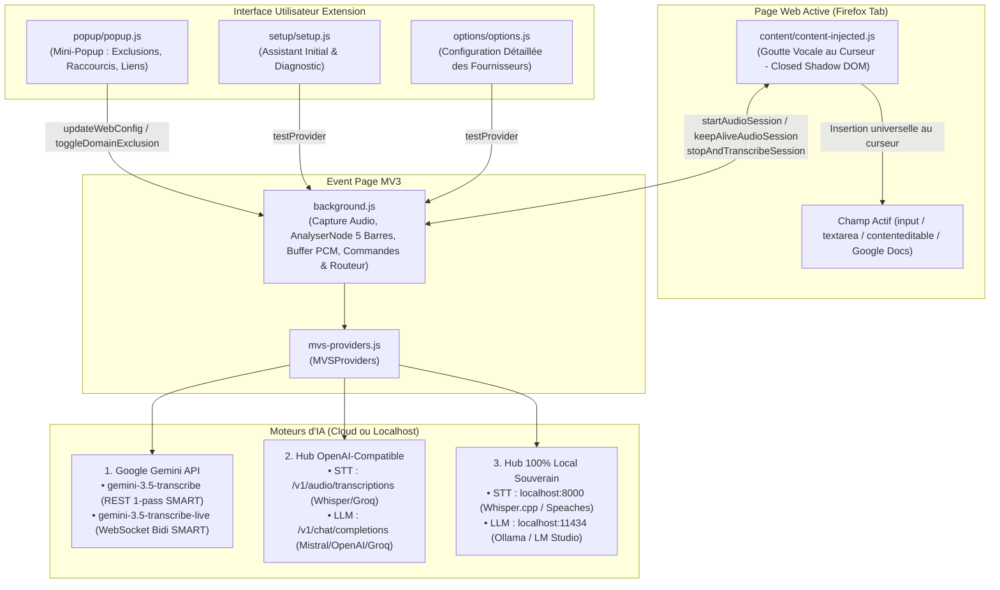

# ARCHITECTURE.md — Magic Voice Scriber for Firefox

Ce document décrit l'architecture technique interne, les flux de données et les choix d'ingénierie de **Magic Voice Scriber** pour Mozilla Firefox (Manifest V3).

---

## 1. Vue d'Ensemble du Système

**Magic Voice Scriber** est une WebExtension Manifest V3 pure en Vanilla JavaScript :
- **Injection Web Universelle (`content/content-injected.js`)** : Détecte les champs éligibles (`<textarea>`, `<input>`, `contenteditable="true"`, Google Docs canvas proxy), affiche la Goutte Vocale (Caret Gem) dans un Shadow DOM fermé (`mode: "closed"`), synchronise l'état et insère le texte transcrit via des setters de prototypes natifs et événements synthétiques.
- **Mini-Popup de Contrôle (`popup/`)** : Déclenchée via l'icône de barre d'outils (`action`), permet d'activer/désactiver le domaine courant, de basculer la présence de la Goutte Vocale, de changer le raccourci (`Alt+Shift+S` ou `Alt+Shift+D`), et d'accéder au Wizard et aux Options.
- **Assistant & Diagnostic Initial (`setup/`)** : Assistant pas-à-pas guidant l'utilisateur pour la configuration de la clé API, le test micro et le choix du mode de voix.
- **Arrière-Plan Privilégié (`background.js`)** : Event Page MV3 gérant la capture microphone via `getUserMedia`, l'analyse spectrale des 5 barres (`AnalyserNode`), le streaming WebSocket Bidi Live avec Manual VAD strict, la synchronisation dynamique des commandes de raccourcis (`api.commands.update`), et le routage sécurisé des requêtes réseau.
- **Moteur Polyvalent (`mvs-providers.js`)** : Encapsule les 3 familles d'IA (Gemini 3.5 Transcribe REST/Live en mode SMART sans systemInstruction, OpenAI/Mistral/Groq, Local Ollama/Whisper) avec isolation cross-domain stricte.



---

## 2. Structure des Fichiers

```text
magic-voice-scriber-firefox/
├── manifest.json                  # Manifeste WebExtension MV3 (Firefox >= 128.0)
├── background.js                  # Event Page : capture micro, 5 barres d'ondes, streaming Live, commands.update
├── mvs-providers.js               # Orchestrateur des 3 familles de moteurs IA + prompts Rambler
├── content/
│   └── content-injected.js        # Goutte Vocale au curseur (Closed Shadow DOM) & insertion universelle
├── popup/
│   ├── popup.html                 # Mini-popup compacte
│   ├── popup.css                  # Styles glassmorphism mini-popup
│   └── popup.js                   # Contrôle d'exclusion de site, Caret Gem switch, raccourci clavier
├── setup/
│   ├── setup.html                 # Assistant de configuration initiale & diagnostic
│   ├── setup.css                  # Styles du wizard
│   └── setup.js                   # Logique pas-à-pas (clé API, test micro, mode vocal)
├── options/
│   ├── options.html               # Interface de paramétrage multi-fournisseurs
│   ├── options.css                # Styles de la page d'options
│   └── options.js                 # Logique de configuration, presets et test de connexion
├── icons/                         # Icônes PNG détourées Alpha (16, 32, 48, 64, 128)
├── _locales/                      # Dictionnaires i18n (en, fr, es, pt, de, vi)
├── test/
│   └── mvs.test.js                # Suite de 22 tests unitaires automatisés
├── build.sh                       # Script de packaging .xpi vers dist/ avec garde-fou DEBUG
└── icon.png                       # Icône officielle 128x128
```

---

## 3. Sécurité & Conformité CSP MV3

- **Zéro innerHTML / outerHTML / insertAdjacentHTML**.
- **Zéro eval() / new Function()**.
- **Zéro boîte de dialogue bloquante** (`window.alert`, `confirm`, `prompt`).
- **Isolation Shadow DOM** pour éviter tout conflit de style avec les pages hôtes.
